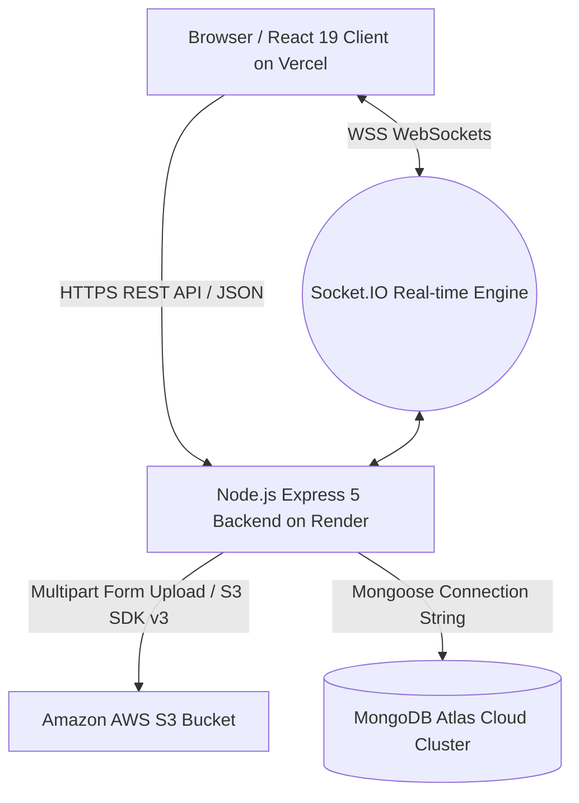

# ECOSWAP — CLOUD COMPUTING LABORATORY (CCL) PROJECT REPORT
## Semester 5 | Third Year Information Technology

---

### 1. Project Introduction
**EcoSwap** is a full-stack, cloud-enabled web application engineered to facilitate sustainable product exchange, waste reduction, and mindful resource consumption across college campuses. Rather than discarding used textbooks, calculators, stationery, drawing kits, and electronics at the end of each semester, campus students can list their unused goods, propose direct or barter exchanges, and coordinate handoffs.

The platform embodies the circular economy model and is built from the ground up to demonstrate modern cloud computing paradigms, including **Platform as a Service (PaaS)**, **Storage as a Service (STaaS)**, **Database as a Service (DBaaS)**, **Security as a Service (SECaaS)**, **Identity & Access Management (IAM)**, **Containerisation (Docker)**, and **Container Orchestration (Kubernetes)**.

---

### 2. Problem Statement
Every academic term, college campuses generate considerable physical waste when departing students dispose of reusable academic tools, textbooks, lab equipment, and daily dorm essentials. Concurrently, incoming students expend significant financial resources purchasing identical items anew. Traditional physical bulletin boards and generic social messaging groups lack structured inventory discovery, item status management, secure identity validation, cloud persistence, and structured exchange tracking.

---

### 3. Project Objectives
1. **Promote Environmental Sustainability:** Divert functional campus goods from local landfills by prolonging item lifecycles.
2. **Implement Cloud Computing Service Models:** Demonstrate practical real-world utilization of IaaS/STaaS (Amazon S3), DBaaS (MongoDB Atlas), PaaS (Render & Vercel), SECaaS, and IAM.
3. **Facilitate Campus Barter & Swap:** Provide structured exchange request workflows, allowing users to send, accept, reject, or cancel swap proposals with real-time status transitions.
4. **Cloud-Native Readiness:** Containerise the application backend using Docker and engineer production-grade Kubernetes manifests for automated scaling and self-healing.

---

### 4. Existing System vs. Proposed System

| Parameter | Existing System (Manual / Campus WhatsApp Groups) | Proposed System (EcoSwap Cloud Platform) |
| :--- | :--- | :--- |
| **Cataloging & Discovery** | Unstructured chat messages, fast message disappearance, no search. | Structured search, real-time category filtering, and condition tagging. |
| **Swap / Barter Workflow** | Unreliable verbal agreements; no transaction state tracking. | Automated Swap Request lifecycle (`Pending` $\rightarrow$ `Accepted` $\rightarrow$ `Exchanged`). |
| **Asset Storage** | Compressed chat media or third-party temporary image links. | **AWS S3 Cloud Storage (STaaS)** with secure uploads and lifecycle management. |
| **Data Persistence** | Lost in chat history or single local spreadsheet. | **MongoDB Atlas (DBaaS)** with cloud clustering, replica sets, and automated failover. |
| **Security & Access Control** | Phone numbers publicly exposed; no role isolation. | **Cloud IAM** with Role-Based Access Control (`user`, `admin`, `auditor`) and Audit Trail. |
| **Availability & Scalability** | Prone to single points of failure. | **Docker containerisation** and **Kubernetes orchestration** with dual pod replicas. |

---

### 5. Technology Stack

* **Frontend:**
  * Framework: React.js (v19)
  * Build Tool: Vite (v8)
  * Routing: React Router DOM (v7)
  * HTTP Client: Axios
  * Icons: Lucide React
  * Real-time: Socket.IO Client (v4.8)
* **Backend:**
  * Runtime: Node.js (v24 LTS / v20 Alpine Container)
  * Framework: Express.js (v5)
  * Cloud Storage Client: AWS SDK for JavaScript v3 (`@aws-sdk/client-s3`)
  * File Handling: Multer (Memory Storage)
  * Security: JWT (`jsonwebtoken`), Password Hashing (`bcryptjs`), CORS
  * Real-time: Socket.IO Server (v4.8)
* **Cloud & DevOps:**
  * DBaaS: MongoDB Atlas (M0 Cloud Cluster)
  * STaaS: Amazon AWS S3
  * PaaS (Frontend): Vercel
  * PaaS (Backend): Render
  * Containerisation: Docker
  * Orchestration: Kubernetes (K8s)

---

### 6. System Architecture

---

### 7. Cloud Computing Syllabus Mapping (Semester 5 CCL)

| CCL Task | Syllabus Topic | EcoSwap Implementation Status | Practical Demonstration Notes |
| :--- | :--- | :--- | :--- |
| **Task 1** | Hosted Virtualization (VirtualBox, KVM) | Conceptual / Lab Host OS | *Demonstrated using Type-2 Hypervisor (VirtualBox / KVM running Ubuntu VM in lab).* |
| **Task 2** | Bare-metal Virtualization (ESXi, Hyper-V) | Conceptual / Type-1 Hypervisor | *Demonstrated via VMware ESXi / Hyper-V server installation in lab.* |
| **Task 3** | Infrastructure as a Service (IaaS) | AWS Cloud Infrastructure | Demonstrated via AWS EC2 compute instances and virtual networking. |
| **Task 4** | Platform as a Service (PaaS) | **Render & Vercel** | EcoSwap backend deployed on Render; frontend deployed on Vercel with automatic CI/CD. |
| **Task 5** | Security as a Service (SECaaS) | **Security Audit Logger & JWT** | Real-time audit trail, token encryption, CORS security policies, and 90-day TTL log auto-purge. |
| **Task 6** | Identity & Access Management (IAM) | **RBAC Matrix & API Keys** | Role-based authorization (`user`, `admin`, `auditor`), SaaS programmatic API key generator. |
| **Task 7** | Storage as a Service (STaaS) | **Amazon S3 Cloud Storage** | Product image upload pipeline via AWS SDK v3, automatic object cleanup on deletion. |
| **Task 8** | Database as a Service (DBaaS) | **MongoDB Atlas** | Fully managed MongoDB cloud cluster with connection resilience and replica set failover. |
| **Task 9** | Containerisation (Docker) | **Multi-stage Dockerfile** | Production container build with `node:20-alpine`, non-root execution (`USER node`), and compose stack. |
| **Task 10** | Container Orchestration (K8s) | **Kubernetes Manifests** | Deployment (2 replicas), Service (NodePort), ConfigMap, Secrets, and Liveness/Readiness probes. |

---

### 8. Cloud Implementation Details

#### 8.1 Storage as a Service (STaaS) — AWS S3
* **Backend Integration:** Built with AWS SDK v3 (`@aws-sdk/client-s3`).
* **Upload Pipeline:** Authenticated users upload image files (`image/jpeg`, `image/png`, `image/webp` up to 5MB). Multer processes the upload directly into an in-memory buffer without saving raw files to server disk.
* **Storage Key Format:** Generated with cryptographically random hashes (`items/${Date.now()}-${randomHash}.${ext}`).
* **Lifecycle Purge:** When a listing is removed, `deleteFileFromS3(item.s3Key)` executes a `DeleteObjectCommand` on AWS S3 to prevent orphaned cloud storage costs.

#### 8.2 Database as a Service (DBaaS) — MongoDB Atlas
* **Cloud Persistence:** Users, Item Listings, Security Logs, and Swap Requests persist in MongoDB Atlas cloud clusters.
* **Connection Resilience:** The backend uses environment variable `MONGO_URI`. If connecting to Atlas encounters a timeout during offline lab demonstrations, it seamlessly engages an in-memory MongoDB fallback server so evaluation is never disrupted.
* **Schema Decoupling:** Binary image blobs are never stored directly in MongoDB; only S3 URLs and S3 object keys are stored.

#### 8.3 Identity & Access Management (IAM) & Security
* **Authentication:** Passwords hashed with bcrypt (salt rounds = 12). Signed JWTs issued with 7-day expiration.
* **Access Control:** Listing modification and deletion are strictly gated by `item.postedBy === req.user.userId`.
* **Programmatic SaaS Access:** Users can generate unique `X-API-KEY` credentials to interact with API endpoints programmatically.
* **Security Audit Trail:** Every authentication attempt, role transition, and API key generation is recorded in `SecurityLog` with IP address, user-agent, and status.

---

### 9. Application Working Flow

1. **User Onboarding:** User registers or logs in; JWT token is persisted securely in local storage and configured into Axios Authorization headers.
2. **Listing an Item:** Authenticated user submits item title, category, condition, location, and description. An image is chosen and uploaded directly to AWS S3 (STaaS). The database stores the item with `status: 'Available'`.
3. **Product Discovery:** Visitors browse items with real-time search, category filters, and live view counters synced through Socket.IO.
4. **Proposing a Swap:** A logged-in user clicks **"Request Swap"** on an item card, writes an offer note, and optionally picks one of their own available listings to barter.
5. **Reviewing Swaps (Dashboard):** The item owner opens the **Dashboard & Swaps** page, reviews incoming proposals, and clicks **"Accept Swap"** or **"Decline"**.
6. **Automatic State Transition:** Accepting a swap atomically transitions the requested item's status to **`Exchanged`**, updates the offered item, and auto-declines conflicting pending offers.

---

### 10. Testing and Verification Summary

All core application functions, cloud APIs, and security controls were verified using automated Node.js test suites:

* **Health Check API (`GET /api/health`):** Verified HTTP 200 response reporting server status, process uptime, database connection status (`readyState: 1`), and active WebSocket clients.
* **Authentication & IAM:** Verified user registration, password hashing, JWT token validation, and profile editing (`PUT /api/auth/profile`).
* **Swap Management Workflow:** Verified creation of swap proposals, retrieval of received/sent requests, and atomic status transitions to `Exchanged`.
* **AWS S3 Pipeline (STaaS):** Verified multipart buffer upload, S3 key generation, and object deletion cleanup.
* **Frontend Build & Linter:** `vite build` completed in **426ms** with 0 errors; ESLint passed with **0 warnings and 0 errors**.

---

### 11. Advantages, Limitations & Future Scope

#### Advantages
* Fully decoupled, scalable microservice-ready cloud architecture.
* Comprehensive coverage of Semester 5 CCL syllabus requirements.
* Zero external asset dependencies with integrated resilient database fallback.
* Real-time WebSocket synchronization for live user engagement.

#### Limitations
* In free cloud tiers (Render / Atlas M0), containers spin down after 15 minutes of inactivity, resulting in a 30-50 second cold start on initial request.
* Local Docker and Kubernetes execution require Docker Desktop / Minikube installed on the evaluation machine.

#### Future Scope
* Implementation of Amazon CloudFront Content Delivery Network (CDN) in front of S3 for edge caching.
* Automated CI/CD deployment pipeline using GitHub Actions to automatically run tests and trigger Render/Vercel webhooks on push.
* Progressive Web App (PWA) support for mobile campus use.

